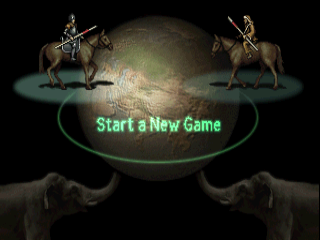
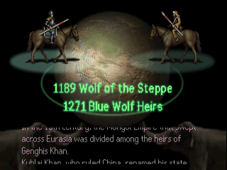
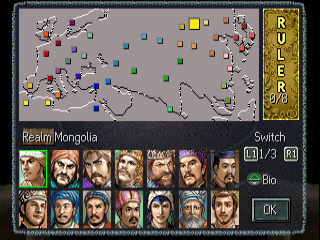
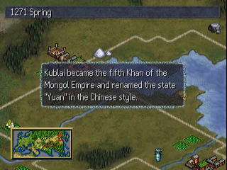
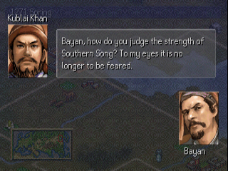
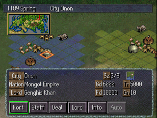
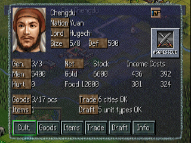
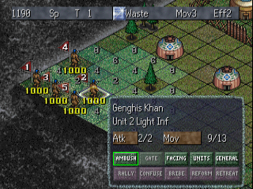
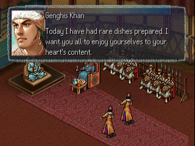

# Genghis Khan IV: Aoki Ookami to Shiroki Mejika — English Translation

A fan translation of **Aoki Ookami to Shiroki Mejika IV** (蒼き狼と白き牝鹿IV, Koei) for the
PlayStation into English. It is the fourth game in Koei's *Genghis Khan* series of historical
strategy games: you lead one of the nations of the 12th–13th century world, from Temujin's
Mongols to Kublai's Yuan, the Southern Song, the Byzantine Empire or the Holy Roman Empire.
You govern your cities, trade goods and technologies along the roads and seas, recruit
generals, hold feasts at court, raise heirs and fight battles on a tactical map, aiming to
unify the world. The series was last released in English with *Genghis Khan II: Clan of
the Gray Wolf*. This fourth game was only released in Japan.

> **This is a full machine translation.** All of the game's text was translated from
> Japanese by an AI model, not by a human translator, and it has not been
> proofread by a fluent Japanese speaker. Expect occasional mistranslations, awkward
> phrasing and inconsistent terms. Corrections are welcome.

> **This is a beta (v0.9.0).** All of the game's text is in English and the main screens
> have been played through, but not every event and battle screen has been seen yet.
> Expect some text that is squeezed, cut short or wrapped oddly.

This repository contains the English text and the tools that build the patch.
It does **not** contain the game, any of its data, or the Japanese script — you need
your own copy of the game.

## Screenshots

| | | |
|:-:|:-:|:-:|
|  |  |  |
| Title menu | Scenario select | Ruler select |
|  |  |  |
| Historical event | Dialogue | Strategy map |
|  |  |  |
| City details | Battle | Court feast |

## What's translated

- All of the game's message text: historical events, court and feast dialogue, advisor
  and envoy reports, diplomacy, recruiting, war messages, consorts and heirs, seasonal
  events, scenario introductions and endings
- All general and ruler biographies
- Menus, labels, buttons and system messages, including the war screens, the feast and
  memory card messages
- The scenario data: generals, consorts, nations, regions, cities, goods, technologies
  and unit types, romanised or translated
- Names the game makes up during play (new generals, children, consorts, new nations and
  cities) are built from English name pools
- Graphics: title menu and scenario titles, the ruler-select banner, map tabs, city
  policy icons, war command labels and other labels, redrawn at build time with an
  original English font
- The name entry screen (new cities, newborn children) uses a Latin alphabet grid
- A proportional English font (original drawings) with word wrap

Long names and labels are shortened where the game's boxes are too small.

## Applying the patch (players)

1. Download the release zip (`Genghis_Khan_IV_English_v<version>.zip`) from the Releases
   page. It contains the patch `genghis_khan_4_en_v<version>.xdelta`, a `.cue` file and
   a README.txt.
2. You need an unmodified image of the Japanese disc (serial `SLPM-86175`) in the usual
   two-track BIN/CUE form (Redump). Only track 1 is patched:

   | Track 1 | |
   |---|---|
   | Size  | 115,262,112 bytes |
   | CRC32 | `D1CC25A8` |
   | MD5   | `5376e27d5cf93563789913a1b7bd6977` |
   | SHA-1 | `8f473168dccffd5f50c1cf1f890457e0ca04ed7a` |

   Track 2 (CD audio, 37,810,752 bytes, CRC32 `40E86050`) is used unchanged.
3. Apply the patch to track 1 with an xdelta tool, e.g.
   [Delta Patcher](https://github.com/marco-calautti/DeltaPatcher) or the command line:

   ```
   xdelta3 -d -s "Genghis Khan - Aoki Ookami to Shiroki Mejika IV (Japan) (Track 1).bin" genghis_khan_4_en_v<version>.xdelta "Genghis Khan - Aoki Ookami to Shiroki Mejika IV (English v<version>) (Track 1).bin"
   ```

4. Put the zip's `Genghis Khan - Aoki Ookami to Shiroki Mejika IV (English v<version>).cue`
   next to the patched track 1 and the original track 2, and open the `.cue` in your emulator.

The patched disc has the same serial, so it uses the same memory card saves as the
Japanese game.

## Building from source

Requirements: Python 3.10+, `xdelta3` (for the patch file).

```
python -m venv .venv
.venv/bin/pip install -r requirements.txt
cp "/path/to/Genghis Khan - Aoki Ookami to Shiroki Mejika IV (Japan) (Track 1).bin" genghis_khan_4_track1.bin
cp "/path/to/Genghis Khan - Aoki Ookami to Shiroki Mejika IV (Japan) (Track 2).bin" genghis_khan_4_track2.bin
.venv/bin/python tools/setup.py      # checks the disc, extracts script/ from it
.venv/bin/python tools/build.py      # writes build/genghis_khan_4_en_track1.bin (+ track 2, .cue) and the .xdelta
```

`tools/setup.py` checks the disc's SHA-1 and generates `script/`, which holds the
Japanese text from your disc for the translation tools. `script/` and `build/` are
never committed.

To make a release package, run `.venv/bin/python tools/package.py 0.9.0` after building:
it writes `release/Genghis_Khan_IV_English_v0.9.0.zip` with the versioned xdelta patch,
the `.cue` and a plain-text README.txt. No disc data is ever packaged.

## Repository layout

| Path | Contents |
|---|---|
| `tl/msg/` | English for the message file `DATA/MESSAGE.CK`, one file per block, by message number (`@N`) |
| `tl/progstr/` | English for strings in the game program and its overlays, by address |
| `tl/scedat.txt`, `tl/newname.txt` | Scenario names (generals, consorts, places, goods...) and the name pools for generated names |
| `tl/gfx.txt` | Text drawn into graphics |
| `tools/setup.py`, `tools/build.py` | Create `script/`; build the patched disc and the patch |
| `tools/tl.py`, `tools/text.py` | Validates translations, line wrapping and page layout (`apply`, `show`, `check`, `stats`) |
| `tools/iso.py`, `msgfile.py` | Disc image (ISO 9660, EDC/ECC), message file format (blocks, overflow blocks) |
| `tools/progstr.py`, `fmtlimit.py` | Program and overlay strings; format-string buffer limits |
| `tools/scedat.py`, `newname.py`, `namegen.py` | Scenario names, name pools, the in-game name generators |
| `tools/vwf.py`, `pixfont.py`, `asm.py` | Proportional font (original drawings), word wrap and layout patches; small MIPS assembler |
| `tools/tim.py`, `gfx.py`, `latinfont.py`, `tinyfont.py` | Texture format and redrawn graphics, fonts for them |
| `tools/package.py` | Makes the release zip (patch + .cue + README.txt with checksums) |
| `tools/dev/`, `tools/emu/` | Development helpers (disassembly, DuckStation automation) |
| `docs/screenshots/` | README screenshots |

## Known issues

- The opening and ending movies keep their Japanese text (the opening verse and the
  staff credits), and the title logo is unchanged.
- Not every rare event has been seen in play yet.
- Some labels are squeezed to fit narrow boxes, and many are abbreviated.

Tested in DuckStation only. Bug reports with a screenshot and where it happened are welcome.

## Credits

- Translation and hacking: [damon-daemon](https://github.com/damon-daemon)
- Aoki Ookami to Shiroki Mejika IV © Koei Tecmo. This is an unofficial fan project, not
  affiliated with or endorsed by Koei Tecmo. Please support the official releases.

## License

The tools, fonts, documentation and English translation text in this repository
are released under the [MIT License](LICENSE). This covers only original work in
this repository: the game itself and all of its content (code, Japanese text,
graphics, audio) are copyright Koei Tecmo and are not included or licensed here.
